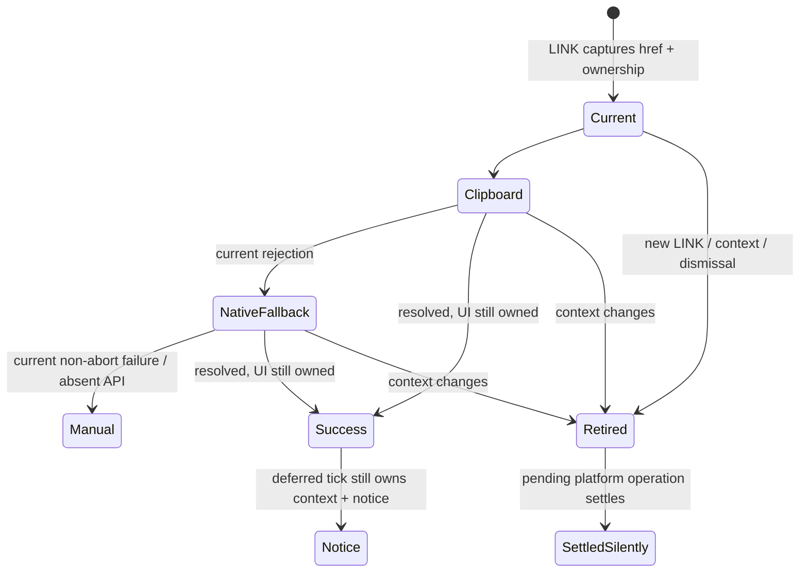

# SHARE-CUSTOMIZATION-HOTFIX — saved links and asynchronous ownership

2026-10-25. Status: generated investigation plan; independent ENG/design review
required before code. Owner authorizes a sound reviewed hotfix through DEV.
Main release and any exact CLAUDE.md change require separate explicit consent.
DUPLICATE-NOTES implementation remains held; SPS is preserved and deferred.

## Diagnosis and scope

**Verified defect:** an older LINK failure can replace a newer LINK's manual
fallback with the old URL and focus/select it. In an isolated Chrome profile on
production main96c4c589, LINK A captured a saved custom layout, actual Edit/fine
control/SAVE changed one bottom position, and LINK B captured the new layout.
Rejecting B first displayed its correct URL. Rejecting A afterward displayed and
focused A's old URL while the registry, durable saved record and bar still held B.
Both request payloads were correct at their own invocation. The bug is completion
ownership, not an encoding/checksum or canonical-identity collision.

**Unresolved owner report:** owner confirms SAVE before fresh LINK, whose supplied
URL omitted the intended custom geometry. Ordinary no-op SAVE and phone fine-
nudge SAVE both retained geometry in registry/record/bar/captured URL and a fresh
receiver. The async defect is independently actionable but is NOT established as
the cause of that report. Do not close the original report merely by fixing it.

**Existing policy:** same note inventories share one saved identity; different
names/layouts/options replace that entry. Keep-both variants need a separate
owner decision and identity/storage design. No such migration belongs here.

Scope: app completion ownership and regression evidence only. No engine, data,
wire/record version, scale grammar, identity, geometry, persistence policy,
localization, browser helper, global configuration or CLAUDE.md edits. Preserve
query/path/origin and the existing literal location.href COPY contract. Do not
bundle SPS. Do not read owner storage/profile/clipboard or publish private links.

## Evidence and provenance

| Claim | Classification and evidence |
|---|---|
| Live refs | Verified read-only ls-remote: DEV667bbf8b1459ba03de1f010e806891071ef1456c; main96c4c589cec0950723b3b5323dc1df5bbc359329. Re-resolve before delivery. |
| Production source | Fetched HTML SHA256 bd9be272474032a8ada18efb8a16f9160ad726ce0f12cf6dec035ac0fe223282 equals main index blob. |
| Normal customization path | Verified bounded native no-op desktop and fine-nudge phone controls, two LINK captures each and first actual outbound URL in a clean receiver; native two-target/same-profile control. Three journeys, exit0/cleanup/census verified. Practice SVG presence only; Edit hit-circle geometry independently checked. |
| Async failure | Verified native V4 probe d8b667bd8e1804f434e0ac796c1578b0ca05430e53a04f8ae33699e260e93ea7, one journey, callback order B→A, old fallback visible/focused, committed B unchanged, exit0, cleanup and pre-existing Chrome680/seven profiles unchanged. Controlled clipboard promises, no OS clipboard or native picker exercised. |
| Other failure paths | Five awaited VM diagnostic cases: control, stale rejection, stale success after modal entry, refused writes with old record, refused writes without old record. VM observations supplement native evidence; injected storage refusal is not owner root cause. |
| Invalid probes | Initial synchronous clipboard assertion invalid before Promise completion. V3 observer used a nonexistent id; caught in independent review, archived UNEXECUTED. Neither establishes an app defect. |
| Untested | Original omission, Safari/iOS clipboard permission timing, native share picker, earliest pre-popstate input interval, actual drag/swap/all layout transforms and full Mac suite. No regression-free guarantee. |

Private raw evidence is under host-local
`/private/tmp/handpan-share-hotfix.urAbvO/evidence/`: native-{noop,nudge,tabs,async}-a0
directories and verified receipts; sh-native-*-a0 supervisor/raw streams;
vm-async-storage-a0 streams. A fresh agent must verify availability/hashes; missing
raw evidence is unavailable evidence, not a fresh pass. Publish only sanitized
receipts. Source and UX notes below have precise inspected symbols/test names.

## Behavioral contract

1. Successful SAVE commits valid options and positions. Without a modal, selected
   registry state, record (or qualified session fallback), canonical bar and a
   new LINK's payload describe that same committed customization. LINK never
   serializes a draft. Intentional count/reset/parent transformations stay pinned.
2. Each LINK captures location.href and analytics deck kind once. Every branch of
   that request uses that immutable payload; never replace A's payload with B's.
3. Only the latest still-current request may reveal/select/focus the manual URL
   field, clear feedback, or announce success. New LINK intent supersedes old UI.
4. Selection including same-ID SAVE/import/replacement; entering Add/Edit/About
   or mobile modal settings; real route/history transitions; and explicit fallback
   dismissal permanently retire earlier UI ownership. A→B→A or open→cancel does
   not revive it. Desktop non-modal settings need not cancel LINK by themselves.
5. A retired clipboard rejection must not start a NEW native-share fallback or
   manual reveal. A native operation already started may finish: no platform
   cancellation guarantee. AbortError remains silent; current non-abort failure
   reveals the captured URL. Successful platform work may still emit the existing
   nonsecret method/deck-kind analytics, even when its UI is suppressed.
6. Unrelated later notices survive old LINK success, including its deferred tick.
   New LINK remains usable after retirement/dismissal, with its own payload and
   normal announcements. Existing repeated-success clear→deferred announcement
   behavior, readonly selection, Escape→LINK focus, blur hide and inertness stay.
7. Do not introduce window-blur cancellation: OS permission/picker UI can blur.
   Suppress focus/reveal while document.hidden; do not add automatic replay on
   return. Visibility/platform behavior is qualified by actual tested coverage.

## Smallest implementation and rejected alternatives

In app JS outside generated regions, add one monotonic LINK UI generation and a
small invalidate/hide helper. Each copy owns a generation and original href;
validity also checks URL/context, enabled LINK, modal state and hidden document.
Invalidate at actual semantic boundaries, not every render or syncRoute no-op.
Hook selectDeck even when identity stays the same, showSheet, openAbout, mobile
openPanel, changed route and popstate/hashchange, and fallback blur/Escape. Check
initialization before any boot selection to avoid a TDZ/startup failure.

Guard reveal before every UI effect; guard native fallback before scheduling AND
inside its Promise; guard success before clearing feedback AND inside the timer.
Use a monotonic announcement revision updated by say() to preserve intervening
notices (text equality alone fails repeated-text/ABA). Capture the revision before
async completion and after the request's own clear. Retiring UI hides the fallback
without moving focus, clearing notices or invoking platform APIs. Analyze blur
ordering so a new revealed field cannot retire itself during focus transfer.
Existing direct announcement reset occurs during sheet teardown; its context is
already invalidated. Keep all helpers local and minimal; no generic task framework.

Reject: re-encode from deck() at copy (drops current query contract); assign new
ids per name/layout (migration); serialize live draft; force reload to reconcile
tabs (loses edits); global storage rewrite; arbitrary waits; raising deadlines;
cancel/retry native OS work; broad UI redesign; refactor unrelated notice writers.
If review finds these boundaries require broader behavior change, stop and amend
the plan with evidence before code, rather than silently widening scope.

## Swarm execution and ownership

Root owns prompt, this plan, coordination, ledger, integration, floors, browser
lease and delivery. Distinct worktrees and independent reasoning are required.

| Lane | Exclusive writes | Dependencies/output |
|---|---|---|
| T — tests | tests/app.test.js, tests/e2e.test.js | Spec-first tests, exact titles/counts, intended baseline assertion RED before A changes; no app/helper edits. |
| A — app | index.html outside generated regions | Implements reviewed contract independently against plan; root integrates only after baseline RED retained. No test edits. |
| M — mutants | new tests/mutants/shc_*.patch; necessary preserved-context legacy refreshes | After test/app commits: generate actual git diffs in disposable committed tree, strip index headers, retain each old kill/suite intent. Root serializes all mutant execution. |
| ENG/design | read/report only | Fresh non-author exact-plan reviews before code, then fresh exact-source final review after evidence. Do not label self-review independent. |

Root tree `/private/tmp/handpan-share-hotfix.urAbvO/integration`, branch
`codex/share-customization-hotfix-20261025`; research source/ux/diagnostics trees
are siblings. Create separate T/A/M siblings only after plan clearance. No worker
browser/test execution unless explicitly assigned by root; one host browser lease
is already held by root/share-hotfix-20261025. Existing SPS token is retired.

## TDD and validation matrix

Proposed new prefix SHC. T freezes exact titles/counts before root runs. Eight unit
groups, two native journeys; increase counts/floors if necessary, never lower any
row. Baseline inspected floors app873/e2e478. Existing share105 and other rows stay.

| Group | Inputs / observable acceptance | Failure detection |
|---|---|---|
| U1 latest fallback | Two delayed LINKs; newer rejects then older rejects, and reverse completion order | Newest URL/selection/focus/notice retained; both original captured payloads exact, query preserved. Baseline intended RED. |
| U2 commit identity | Custom layout SAVE with same id, selection away/back, repeated same selection | Old callbacks never reveal; new LINK encodes committed options; no draft serialization. Literal independently fixed fixture. |
| U3 modal lifecycle | Add, Edit, About, mobile panel; open/cancel/return, both old reject and success | No old fallback/focus/notice/native fallback; visible current modal focus preserved. Desktop nonmodal positive control. |
| U4 success/timer ownership | Old/new successes, tick queued before new LINK/context; unrelated new notice incl identical text | No old clear or notice; normal repeated current clear/deferred success still works. |
| U5 native branches | Missing clipboard; rejected clipboard; share resolved/non-abort/AbortError; retired between rejection and scheduled native call | Current immutable URL through branches, Abort silent, no new native API after retirement, already-started completion silent. |
| U6 dismissal | Revealed field blur/Escape, queued old callbacks, new LINK afterward | Dismissal stays closed; Escape returns LINK focus; new operation works. |
| U7 route/history | Real handler boundaries in VM with explicit model limitations: changes, pending SAVE pop, away/back; no-op sync positive | No ownership resurrection or extra history pushes; query retained. Do not count VM as native history. |
| U8 visibility/refusal/privacy | Hidden document; disabled/refused link; unchanged positive paths and analytics allowlist | No hidden focus/reveal; no secret URL/name/id analytics; restore allows new operation, refusal unchanged. |
| E1 saved-layout + race | Actual Edit/fine/SAVE, two LINK clicks, controlled promises B→A | Saved geometry/record/bar/new fallback remain B after old settlement; query and both invocation payloads literal. Fresh receiver of captured B renders matching pitch-keyed geometry without sender storage. Desktop. |
| E2 modal/focus | Phone380×780, real Edit entry/cancel; old success and failure settled, fresh LINK afterward | No focus stealing or stale announcement/fallback; current LINK works, field readonly/full selection, blur/Escape and hit targets retain existing behavior. |

Use controlled API sinks, not OS clipboard/profile. Await actual intercepted
invocation and deterministic Promise drain/event-loop completion; no arbitrary
delay masking a race. Stale-suppression tests must finish even when the old app
callback performs no DOM mutation. Uncaught TypeError/startup/timeout/zero match is
invalid RED, never an intended failure or kill. No retry-until-green.

T first supplies tests without app edits; root runs each new intended failing
group against DEV baseline and archives expected assertion failures. Positive
controls that already pass are controls, not fabricated RED. Root then integrates
A and reruns the exact selection plus all app units and affected native journeys.
Every new group gets a generated fault with clean-header PASS and mutated named-
assertion FAIL, no skips/cancels/timeouts. Refresh changed legacy context without
weakening its original fault. Root raises app/e2e rows to observed counts (initial
target881/480), runs existing relevant share/route/refusal/success/focus/storage
regressions, generated-source/data checks, mutant refresh check and final review.

Use reviewed supervisor (180s targeted native /60s VM) and raw stdout/stderr,
immutable source hashes and resource census. Reused baseline positive controls
are not repaired-code passes; re-execute the affected final candidate. No full Mac
claim. Eight-language copy unchanged; no font/layout edits mean full panel-fit
matrix is unnecessary unless actual diff changes geometry/text. Safari/iOS/native
picker QA remains separate, explicitly qualified.

## Ordered gates, recovery and delivery

1. **Pre-code:** independently review this generated plan against frozen prompt
   1489e53d, source/UX notes and native evidence. Resolve all material ENG/design
   findings and recheck exact hash. Record original report versus proven bug.
2. **RED:** isolated T tests; root records exact selected count and intended
   assertion failures on unmodified app. No app integration before this gate.
3. **GREEN:** integrate scoped A, all new tests/control regressions pass; prove
   every new mutant plus any necessary old context refresh in disposable tree.
   Failure retains raw evidence; stop on changed data, unowned resource or broader
   scope. Three failed same-hypothesis attempts require revised investigation.
4. **Final review:** independent non-author exact-head ENG/source and UI/focus
   review, addressed findings, final diff excludes generated/data/CLAUDE/globals.
5. **Full CI:** push scoped branch, main-target DRAFT/HELD CI PR, full Linux validate
   at exact reviewed final head. All required jobs/artifacts and named verdicts
   inspected, no skips/cancels/timeouts masquerading as success. Create same-head
   DEV PR under established model; additional combined-head CI if DEV advances.
6. **DEV:** merge only after gates; compare actual served index/resource bytes to
   merged source and exercise affected saved-LINK/race/receiver/modal journeys.
   Update ledger, refs, CI/raw receipts, worktree and last/next action. Report
   owner QA available, original reproduction unresolved, Safari/native limits.
7. **Main:** HOLD for explicit owner consent and outstanding release ordering.
   No implicit out-of-order release. Owner QA and native-device findings can
   trigger a reviewed scoped follow-up; do not claim original issue resolved.

No storage schema change means rollback is a scoped revert PR through review/CI,
not resetting shared history. Pending requests cannot be forcibly undone; a reload
starts a new page and new tokens. Preserve all worktrees/logs before interruption.
Do not delete/rewrite saved scales as diagnosis or recovery. Recovery for an
owner's earlier overwritten variant requires their retained original link/export;
do not invent nonexistent historical records. Production rollback requires owner.

## Open questions and stop conditions

Owner confirmed saved positions before LINK; do not reinterview that. Whether the
two variants were in separate tabs remains pending, useful to original diagnosis
but not a blocker for this independently reproduced race. Original omission needs
a minimal reproducible sequence or a voluntarily supplied sanitized export/current
saved state; no private browser inspection. Keep-both variant policy is separate
unapproved scope. Missing native capability or CI evidence blocks the respective
claim, not reason to weaken tests. CLAUDE/global/data/wire changes or a broader
persistence repair stop this implementation and require reviewed scope/approval.

References: [frozen prompt](../prompts/2026-10-25-share-customization-hotfix.md),
[source research](2026-10-25-share-customization-source-research.md),
[UX research](2026-10-25-share-customization-ux-research.md),
[coordination](2026-10-25-share-customization-hotfix-coordination.md),
[ledger](../WORKSTREAMS.md), [test contract](../../tests/CONTRACT.md),
[browser runbook](../testing/browser.md).
