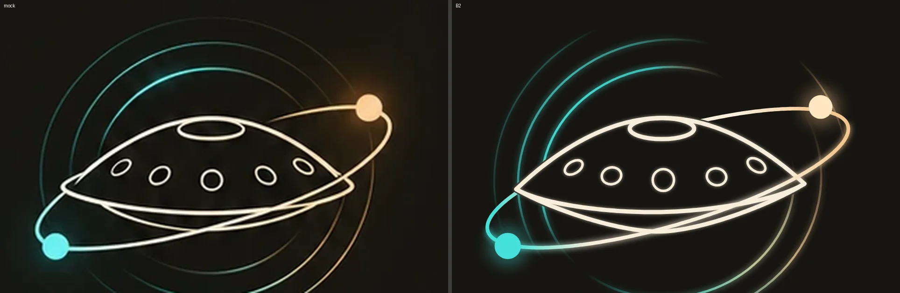

# Plan: redraw the Handpan Theory mark to match the brand board

Status: PLAN, awaiting owner approval. Nothing shipped: `docs/brand/logo/`
is unchanged. Prompt: `docs/prompts/2026-10-31-logo-redraw-plan.md`.

## Result in one line

A measured redraw (spike B2) puts every landmark within 0.8% of the rim
half-width of the mock (v1: 13.6%) and lifts stroke agreement from F1 0.59
to 0.93. All three owner findings are fixed in the spike: the bottom shell,
the ring circles and the slanted orbit.

## How it was measured

Source: the PRIMARY LOGO (DARK) mark on
`docs/brand/reference/brand-board.webp`, board pixels, y down. Tooling is in
`docs/brand/redraw/` and reruns from the repo root
(`python3 docs/brand/redraw/extract.py`, then `candidates.py OUT`, then
`harness.py NAME OUT/NAME.svg OUT/NAME_landmarks.json OUT`; needs numpy,
scipy, scikit-image, Pillow and the preinstalled Playwright).

- Pixel-grid zooms (`grid.py`) for points read by eye.
- Column brightness runs (`extract.py`) for the pan curves. The orbit crosses
  the right half of the pan, so the right half is ambiguous there; the pan
  curves are fitted to the left half mirrored about the pan centre (a real
  handpan is symmetric; open question 1).
- An algebraic ellipse fit for the orbit (`orbitfit.py`): 24 points, 21
  within 4% of the curve.
- RANSAC circles on teal and on warm pixels, then one ellipse per ring fitted
  to both sets (`measure4.py`): the rings are slightly flattened ellipses,
  not circles. Their brightness and colour around each ring were sampled
  every 5 degrees (`ringprof.py`, `ring_profiles.json`).
- Cross-check: the stacked lockup's teal dot, gold dot and dome top agree
  with the primary within about 3% of W. The app icon is a looser drawing
  (its orbit tilts more), so the primary mark wins where they differ.

## Landmark table

`W` = half the distance between the rim's two lens points = 102.85 board px;
origin = their midpoint (668.85, 258.65). Normalised = (value - origin) / W,
y down. Source of truth in code: `docs/brand/redraw/landmarks.py`.

| landmark | board px | normalised |
| --- | --- | --- |
| lens point left / right | (566.0, 260.6) / (771.7, 256.7) | (-1.000, 0.019) / (1.000, -0.019) |
| dome top (ding's upper edge) | (670.0, 209.5) | (0.011, -0.478) |
| ding centre, rx, ry | (670.0, 217.2), 23.0, 7.5 | (0.011, -0.403), 0.224, 0.073 |
| rim front edge, lowest | (668.0, 277.0) | (-0.008, 0.178) |
| rim front edge at x 600 | (600.0, 271.0) | (-0.669, 0.120) |
| bottom shell, lowest | (665.0, 291.0) | (-0.037, 0.315) |
| bottom shell at x 600 / 620 | (600, 275.5) / (620, 283.0) | (-0.669, 0.164) / (-0.475, 0.237) |
| tone fields 1-5 | (607,245) (634,251) (671,254) (709,251.7) (737.5,243.5) | (-0.601,-0.133) (-0.339,-0.074) (0.021,-0.045) (0.390,-0.068) (0.667,-0.147) |
| orbit centre | (674.2, 252.7) | (0.052, -0.058) |
| orbit semi-axes | 134.0 x 33.8 | 1.303 x 0.329 |
| orbit tilt | 16.4 deg, rising to the right | |
| teal dot centre, r | (559.9, 301.3), 9.4 | (-1.059, 0.415), 0.091 |
| gold dot centre, r | (783.3, 201.7), 8.5 | (1.113, -0.554), 0.083 |
| ring inner (centre; a x b) | (674.1, 255.8); 90.6 x 82.6 | (0.051, -0.028); 0.881 x 0.803 |
| ring middle | (675.5, 253.8); 108.5 x 100.3 | (0.065, -0.047); 1.055 x 0.975 |
| ring outer | (676.5, 252.0); 126.5 x 118.0 | (0.074, -0.065); 1.230 x 1.147 |
| ring tilt | 9.8 deg, rising to the right | |
| strokes: pan, orbit, fields, rings | 3.0, 2.6, 1.8, 1.5 px | 0.029, 0.025, 0.018, 0.015 |

What the numbers say about the three findings:

1. **Bottom shell.** Three curves meet at the two lens points: the dome rises
   0.48 W above the lens line, the top shell's front edge sags 0.18 W below
   it, and the bottom shell sags 0.32 W (about two thirds of the dome's
   height). The bottom shell is narrower than the rim: it leaves the rim's
   front edge near u = -0.75 and returns near u = 0.8. v1 sagged only
   0.13 W and 0.18 W, so its bottom shell read as a thin sliver.
2. **Rings.** Ellipses, not circles, tilted 9.8 degrees, centred a little
   right of and above the pan centre. Brightness by angle (y-up, from each
   ring's centre): the inner ring is bright teal from about 60 to 135 degrees,
   dark at the upper right (0-55) and the left (150-220), and bright again
   below the pan from about 225 to 320 degrees, shifting teal to gold past 290.
   The middle ring has the same two lobes, weaker on top, with a faint gold
   glint at 5-30 degrees. The outer ring shows only a faint teal lobe at
   115-175 degrees. The pan hides all of them.
3. **Orbit.** One closed ellipse, 1.30 W by 0.33 W, tilted 16.4 degrees.
   The teal dot sits on the front half just past the left tip; the front half
   runs under the bottom shell, crossing it at about u = -0.1, and climbs to
   the right tip; the back half carries the gold dot and disappears behind
   the dome at about u = 0.35, and on the left it climbs from the teal dot to
   the left lens point, where the pan hides it. v1 was 15 degrees, 6% too
   short, 15% too fat, stopped at the teal dot and cut through the rim.

## Spikes

| spike | approach | bright-stroke F1 | pan F1 | rings F1 | worst / mean landmark error (% W) | notes |
| --- | --- | --- | --- | --- | --- | --- |
| v1 | shipped `mark-full.svg`, scaled onto the lens points | 0.588 | 0.656 | 0.287 | 13.6 / 5.4 | baseline |
| A | measured orbit, rings, dots; pan curves as superellipse caps (2 fitted params each) | 0.934 | 0.941 | 0.792 | 0.6 / 0.1 | curves are polylines; harder to hand-tune |
| B | as A, pan curves as symmetric cubic Beziers fitted by least squares (RMS 0.75 / 0.46 / 0.41 px) | 0.934 | 0.941 | 0.792 | 0.8 / 0.2 | each curve is two cubic segments (`evidence/fits.json`) |
| **B2** | B, rings as a few gradient arcs per ring ("lobes"), lighter pan glow | 0.934 | 0.944 | 0.784 | 0.8 / 0.2 | **pick**: no seam ticks, closest overall look |

F1 = agreement of rendered strokes with the mock's strokes within 1.5 px
(rings: dim strokes outside the pan, 2 px). A and B ring F1 is the same
because they share ring code: 72 coloured 5-degree segments, whose overlaps
showed as dashes (`evidence/B-side.webp`). B2 drops them for 2-3 arcs per
ring, each with a linear gradient whose stops come from the measured profile.

Auto-tracing (the prompt's approach C) was not run: A and B met the
acceptance bar with clean primitives, and a trace would only reproduce the
mock's raster noise. Evidence: `docs/brand/redraw/evidence/` (side-by-sides,
onion skin, difference images, metrics JSON, the B2 SVG).

## Redraw steps (the pick: B2)

All in `docs/brand/make_logo.py`; no SVG is edited by hand.

1. **One geometry table.** Replace the hand-tuned constants with the
   normalised landmark table above (a dict in W units). The generator scales
   it to the output box; the mark's bounding box now includes the outer ring
   and the orbit tips, so recompute the viewBox from the geometry with a
   0.05 W margin.
2. **Pan.** Three symmetric curves through the lens points, each two cubic
   segments (control points from `evidence/fits.json`, normalised): dome,
   top-shell front edge, bottom shell. Then the ding ellipse and the five
   fields (rotations -32, -14, 0, 14, 32 degrees; rx x ry 0.068 x 0.041,
   0.068 x 0.058, 0.074 x 0.076, mirrored). Pan silhouette for masking = dome
   down to the bottom shell.
3. **Orbit.** One ellipse from the table. Front half (local sin t > 0) drawn
   over the pan; back half masked by the pan silhouette. Stroke gradient along
   the teal-dot-to-gold-dot axis: teal, warm-white from 0.22 to 0.78, gold.
   Dots at their measured centres and radii (both lie on the ellipse).
4. **Rings.** Three tilted ellipses; each bright stretch is one SVG
   elliptical-arc command (`A`, not a polyline) with a linear gradient whose
   stops (offset, colour between `accent-teal` and `accent-gold`, opacity)
   are sampled from `ring_profiles.json`; masked by the pan silhouette.
5. **Glow.** Rings, orbit and dots: Gaussian glow, sigma 0.021 W. Pan: soft
   glow, sigma 0.012 W at 55% alpha. Dot bloom: sigma 0.05 W at 35%.
6. **Variants.** Same geometry everywhere. Single colour and mono: every
   stroke in one ink, ring lobes keep their opacity ramps, no glow or bloom.
7. **Small mark (16-48px).** `evidence/small-sizes.png` shows the full mark
   turning to mush below 48px. `mark-small`: drop the rings and the field
   ellipses (three filled dots instead), keep the dome, top-shell front edge,
   bottom shell and the closed orbit, strokes x2.2, dots x1.4.
8. **Lockups and icons.** Re-derive the lockup offsets and the icon scale
   from the new bounding box (the mark is wider than v1's).
9. **Check.** Add `--check` to the harness flow: render the generated
   `mark-full` in board coordinates and fail unless worst landmark error
   is 2% W or less, bright-stroke F1 is 0.92 or more, pan F1 0.93 or more,
   rings F1 0.75 or more. Then the owner reviews overlays at the primary,
   stacked-lockup and app-icon sizes.
10. **Publish.** Regenerate `docs/brand/logo/`, re-upload the Logos group of
    the design system (https://claude.ai/artifact/93knqkDWTEUZe8iGLktZYB) and
    update its README's logo notes (small-mark rules from step 7).

Effort: steps 1-6 are a port of `candidates.py` into the generator (about
an hour); 7-10 about another hour including review renders.

## Open questions (default in bold)

1. The mock's right half of the pan is crossed by the orbit and is
   ambiguous; draw the pan **symmetric**, or follow the raster's slight
   asymmetry?
2. Ring brightness: **copy the measured profile**, including the bright lobe
   under the pan, or calm the lower lobes for a quieter mark?
3. Dot cores: the mock's gold dot core is near-white cream and the teal dot
   a lighter cyan. Tokens only: **teal dot `accent-teal`; gold dot core
   `warm-white` with an `accent-gold` bloom**, or add two lighter tokens?
4. Small mark: **drop the rings below 48px**, or keep one ring?
5. App icon: it differs from the primary (steeper orbit). **Use the primary
   geometry everywhere**, or a separate icon geometry?
